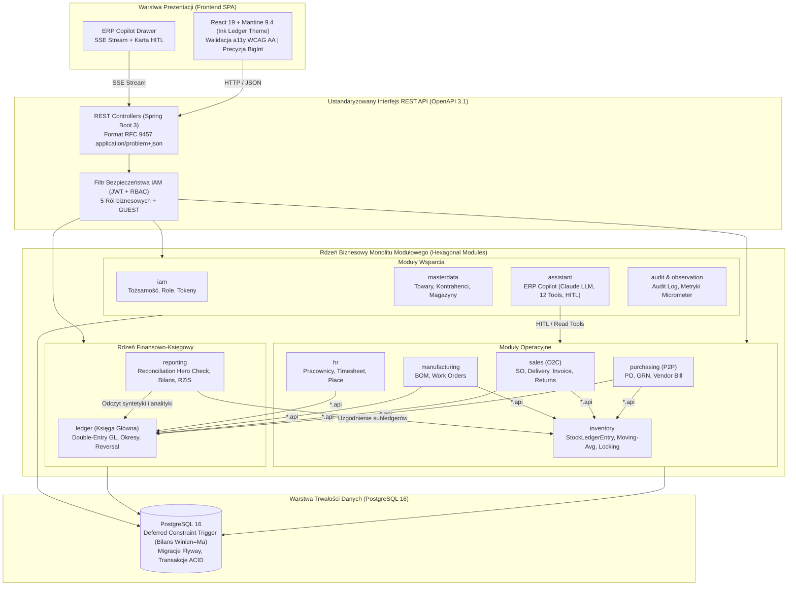
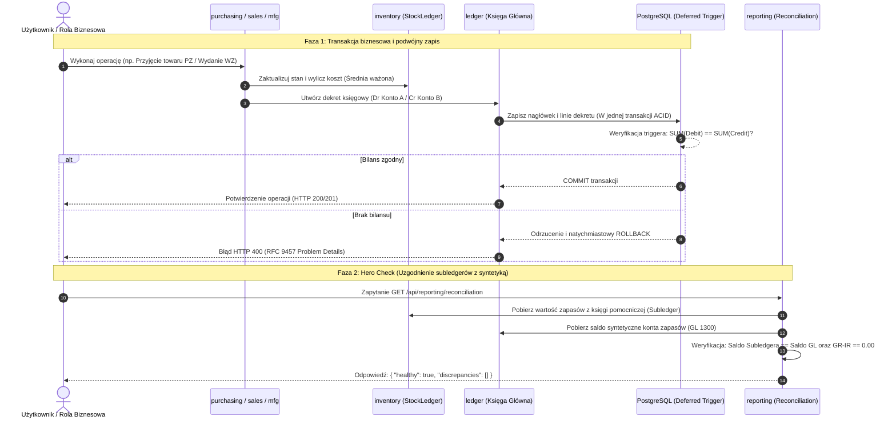

# PLAN TESTÓW OPROGRAMOWANIA (SOFTWARE TEST PLAN)
## System ERP dla Przedsiębiorstwa Produkcyjnego (Manufacturing ERP)
**Przedmiot:** Jakość w procesie wytwarzania oprogramowania  
**Standard dokumentu:** Zgodny z IEEE 829 / ISO/IEC/IEEE 29119 oraz szablonami i przykładem projektowym z przedmiotu  
**Wersja dokumentu:** 1.0.0  
**Status:** Zaakceptowany do realizacji  
**Data:** 18 października 2026 r.  

---

### Metadane dokumentu i zespół autorski

| Rola w zespole | Imię i nazwisko | Kontakt (adres e-mail) |
|:---|:---|:---|
| **Autor przewodni** | Główny Inżynier Jakości (QA Lead) | qa-lead@erp-project.org |
| **Współautorzy** | Zespół Inżynierii Jakości i Testów (SDET), Architekt Backend | dev-qa-team@erp-project.org |
| **Recenzenci** | Kierownik Projektu, Właściciel Produktu (Product Owner) | po-management@erp-project.org |

---

## Historia zmian (Dziennik rewizji dokumentu)

| Rewizja | Data | Modyfikujący | Zmodyfikowane paragrafy | Komentarz / Zakres zmian |
|:---:|:---:|:---:|:---:|:---|
| **0.1.0** | 2026-10-18 | Główny Inżynier QA | Wszystkie | Utworzenie pierwotnej wersji szkieletu planu testów na podstawie analizy repozytorium ERPSystem i szablonu przedmiotu. |
| **0.5.0** | 2026-10-18 | Główny Inżynier QA | Rozdz. 4–9 | Włączenie szczegółowych reguł niezmienników księgowych (Double-Entry GL, Subledger Reconciliation, GR-IR, Deferred-COGS, WIP). |
| **0.9.0** | 2026-10-18 | Zespół QA & Architekt | Rozdz. 10–14 | Dodanie specyfikacji przypadków testowych (TC-001 do TC-010), macierzy RBAC oraz wytycznych dla modułu ERP Copilot (AI). |
| **1.0.0** | 2026-10-18 | QA Lead / Kierownik Jakości | Całość dokumentu | Finalna redakcja i formalne zatwierdzenie Planu Testów do realizacji w procesie CI/CD i iteracjach Scrum. |

---

## 1. Wstęp

Niniejszy dokument przedstawia **Plan Testów** dla zintegrowanego systemu klasy ERP dedykowanego przedsiębiorstwom produkcyjnym (**Manufacturing ERP**), dostępnego w repozytorium [ERPSystem](https://github.com/q86865511/ERPSystem). Dokument stanowi bezpośrednią realizację wymagań i wytycznych dla przedmiotu *„Jakość w procesie wytwarzania oprogramowania”*, bazując na strukturze i dobrych praktykach inżynierii jakości oprogramowania.

W kolejnych rozdziałach dokumentu opisano wyniki prac:
1. **Teoretycznych**, mających określić kontekst testowania, model dziedzinowy systemu ERP (ze szczególnym uwzględnieniem księgi głównej podwójnego zapisu, wyceny magazynowej metodą średniej ważonej oraz rozliczeń produkcyjnych) oraz ryzyka z niego wynikające.
2. **Koncepcyjnych**, mających określić optymalne podejście do testowania systemu Manufacturing ERP na wszystkich poziomach piramidy testów (jednostkowym, architektonicznym, integracyjnym, kontraktowym oraz E2E) oraz odpowiednie techniki projektowania testów.
3. **Projektowych**, mających określić wymagane metryki jakościowe, personel, organizację środowisk testowych oraz harmonogram testowania systemu w metodyce Scrum.

---

## 2. Terminologia i definicje

| Termin / skrót | Opis |
|:---|:---|
| **Manufacturing ERP / System** | Zintegrowany system informatyczny klasy ERP do zarządzania procesami produkcji dyskretnej, zakupów, sprzedaży, magazynu, finansów oraz kadr i płac. |
| **GL (General Ledger)** | Księga Główna – centralny rejestr księgowy ewidencjonujący wszystkie zdarzenia gospodarcze w ujęciu bilansowym. |
| **Double-Entry GL** | Zasada podwójnego zapisu: każda transakcja gospodarcza bilansuje się tak, że $\sum \text{Debit} = \sum \text{Credit}$ w tej samej transakcji bazodanowej. Brak bilansu uniemożliwia zatwierdzenie transakcji. |
| **Subledger** | Księga pomocnicza (np. magazynowa `StockLedgerEntry`, rozrachunków z dostawcami AP, rozrachunków z odbiorcami AR) uzgadniana bezpośrednio z odpowiadającym jej kontem syntetycznym w Księdze Głównej. |
| **GR-IR (Goods Receipt / Invoice Receipt)** | Konto przejściowe rozliczenia zakupu (konto 2150) bilansujące różnice czasowe między fizycznym przyjęciem towaru a otrzymaniem faktury zakupu. Na koniec pełnego cyklu zakupowego saldo wynosi 0.00. |
| **Deferred-COGS** | Odroczony koszt własny sprzedaży (konto 1340) – koszt wydania towaru (WZ) przeksięgowywany na rzeczywisty koszt COGS (konto 5000) dopiero w chwili wystawienia faktury sprzedaży. |
| **WIP (Work in Progress)** | Produkcja w toku (konto 1320) – konto przejściowe gromadzące koszty pobranych materiałów, czyszczone do zera w momencie przyjęcia wyrobu gotowego na magazyn. |
| **Moving-Average Valuation** | Wycena zapasów metodą średniej ważonej ruchomej z rekalkulacją kosztu po każdej dostawie i rewaluacją zapasów przy odchyleniach cenowych (brak odrębnego konta odchyleń PPV). |
| **RBAC (Role-Based Access Control)** | Kontrola dostępu oparta na rolach: ADMIN, ACCOUNTANT, WAREHOUSE, SALES, HR oraz profilu tylko do odczytu GUEST. |
| **RFC 9457 (Problem Details)** | Standard ujednoliconego formatu zwracania komunikatów o błędach HTTP w formacie `application/problem+json`. |
| **ArchUnit** | Narzędzie do automatycznego testowania architektury kodu Java, weryfikujące reguły izolacji warstw i modułów monolitu modularnego. |
| **Testcontainers** | Biblioteka umożliwiająca uruchamianie rzeczywistych instancji baz danych (w tym PostgreSQL 16) w kontenerach Docker na potrzeby testów integracyjnych. |
| **HITL (Human-in-the-Loop)** | Wymóg bezwzględnego zatwierdzenia przez człowieka wszelkich operacji zapisu/modyfikacji danych inicjowanych przez asystenta AI (ERP Copilot). |
| **Weryfikacja** | „Czy budujemy produkt właściwie?” – sprawdzenie zgodności oprogramowania ze specyfikacją techniczną, architektoniczną i kontraktem API. |
| **Walidacja** | „Czy budujemy właściwy produkt?” – sprawdzenie, czy oprogramowanie realizuje rzeczywiste potrzeby biznesowe użytkowników końcowych. |

---

## 3. Zakres dokumentu

Niniejszy plan testów obejmuje zintegrowany system **Manufacturing ERP** składający się z modularnego backendu w technologii Java/Spring Boot, relacyjnej bazy danych PostgreSQL, aplikacji klienckiej w technologii React oraz wbudowanego modułu asystenta AI (ERP Copilot). Dokument obejmuje wszystkie fazy testowania systemu (zarówno na poziomie specyfikacji architektury i strategii, jak i szczegółowych scenariuszy i przypadków testowych), stanowiąc nadrzędny dokument kontroli jakości w projekcie.

---

## 4. Opis testowanego systemu (System Manufacturing ERP)

System Manufacturing ERP został zaprojektowany i zaimplementowany jako **Monolit Modułowy (Modular Monolith)** z heksagonalnym podziałem na moduły biznesowe. Każdy moduł komunikuje się z pozostałymi wyłącznie za pośrednictwem opublikowanego interfejsu (pakiet `*.api`), bez bezpośredniego odwoływania się do wewnętrznych encji czy tabel obcych modułów.

*Rysunek 4.1: Architektura monolitu modułowego (Modular Monolith) systemu Manufacturing ERP i granice modułów*

*Rysunek 4.2: Przepływ transakcyjny operacji Buy -> Make -> Sell oraz mechanizm uzgadniania ksiąg (Hero Check)*

Głównymi komponentami systemu są:
1. **Moduł `ledger` (Księga Główna):** Centralne jądro bilansowe. Obsługuje dekrety z podwójnym zapisem, zamykanie okresów obrachunkowych, zamknięcie roku oraz bezbłędne odwracanie wpisów (Reversal).
2. **Moduł `masterdata`:** Kartoteki towarów, kontrahentów (klientów i dostawców), magazynów, lokacji oraz reguł księgowania.
3. **Moduł `inventory`:** Księga pomocnicza zapasów (`StockLedgerEntry`), dwustronne ruchy magazynowe, kalkulacja średniej ważonej ruchomej oraz pesymistyczne blokowanie stanów magazynowych (`ItemCostState`).
4. **Moduł `purchasing` (Zakupy - P2P):** Zamówienia zakupu (PO), przyjęcia zewnętrzne (GRN), faktury dostawców (Vendor Bill) z rozliczeniem konta GR-IR i subledgera AP.
5. **Moduł `sales` (Sprzedaż - O2C):** Zamówienia sprzedaży (SO), wydania towarów (Delivery), faktury sprzedaży (Invoice) z rozliczeniem Deferred-COGS, obsługa zwrotów (Customer Returns) i subledgera AR.
6. **Moduł `manufacturing` (Produkcja):** Jednopoziomowe struktury wyrobów (BOM), cykl życia zleceń produkcyjnych (Work Order) oraz rozliczanie kosztu rzeczywistego produkcji w toku (WIP).
7. **Moduł `payments` (Płatności):** Płatności wychodzące i przychodzące z alokacją kwotową do faktur.
8. **Moduł `hr` (Kadry i Płace):** Ewidencja pracowników, struktura organizacyjna, wnioski urlopowe, karty czasu pracy, kalkulacja płac oraz automatyczny, zbilansowany dekret płacowy do Księgi Głównej (`Dr 6100 / Cr 2200 + 2210 + 2220`).
9. **Moduł `iam` (Zarządzanie tożsamością i dostępem):** Uwierzytelnianie tokenami JWT (Access Token w pamięci + Refresh Token w bezpiecznym ciasteczku httpOnly) oraz autoryzacja 5 ról + gość.
10. **Moduł `assistant` (ERP Copilot):** Asystent AI bazujący na modelu Claude udostępniający 12 narzędzi analitycznych ze ścisłą blokadą Human-in-the-Loop dla operacji modyfikujących.
11. **Moduł `reporting`:** Raporty finansowe (Bilans, Rachunek Zysków i Strat, Zestawienie Obrotów i Sald) oraz centralny raport uzgodnienia ksiąg (**Reconciliation Hero Check** dostępny pod adresem `GET /api/reporting/reconciliation`).
12. **Frontend (SPA):** Klient webowy React 19 z biblioteką Mantine 9.4 (motyw *Ink Ledger*), zoptymalizowany pod kątem dostępności WCAG AA, dwujęzyczny (EN/ZH) i wolny od błędów zaokrągleń zmiennoprzecinkowych.

Interfejs komunikacyjny opiera się na ustandaryzowanym **REST API** udokumentowanym w standardzie OpenAPI 3.1 / Swagger UI. Wszystkie odpowiedzi o błędach są zunifikowane zgodnie ze standardem RFC 9457 `application/problem+json`.

---

## 5. Zakres testowania

W ramach planu testów weryfikacji podlegają następujące elementy systemu:
1. Komponenty domenowe i logika biznesowa backendu (w tym niezmienniki finansowe).
2. Granice modułów i czystość architektury (kontrola zależności pakietowych).
3. Warstwa dostępu do danych, relacje, migracje Flyway oraz triggery bazy PostgreSQL 16.
4. Interfejsy REST API (kontrakty, autoryzacja RBAC, walidacja danych Bean Validation, obsługa błędów).
5. Interfejs użytkownika (komponenty, routing, stan aplikacji, prezentacja kwot walutowych, dostępność a11y).
6. Komunikacja między modułami oraz integracja z zewnętrznym modelem asystenta AI (ERP Copilot).

W ramach procesu testowego przeprowadzone zostaną testy na poziomach:
- **Jednostkowym (Unit)**
- **Architektonicznym (Architecture Governance)**
- **Integracyjnym (Integration)**
- **Systemowym / End-to-End (E2E)**
- **Dostępności (Accessibility - a11y)**

Zostaną wykorzystane następujące typy testów: **funkcjonalne, strukturalne, regresyjne, bezpieczeństwa, współbieżności oraz związane ze zmianą**.

---

## 6. Założenia i ograniczenia

### 6.1 Założenia
1. **Precyzja finansowa:** Całkowity brak arytmetyki zmiennoprzecinkowej `float`/`double`. Kwoty w backendzie reprezentowane są wyłącznie przez klasę `BigDecimal`, a w komunikacji sieciowej JSON serializowane jako ciągi znaków (String).
2. **Atomowość transakcyjna:** Każde zdarzenie biznesowe wywołuje powiązany dekret w Księdze Głównej w tej samej transakcji bazodanowej.
3. **Niezmiennik bilansowy:** Odrzucenie asymetrycznych transakcji księgowych jest wymuszone na poziomie silnika bazy danych przez `DEFERRED CONSTRAINT TRIGGER`.
4. **Izolacja środowisk:** Testy integracyjne backendu są uruchamiane w odizolowanym kontenerze Docker za pomocą biblioteki Testcontainers PostgreSQL 16.

### 6.2 Ograniczenia
1. **Jedna waluta:** System operuje w jednej walucie bazowej (brak mechanizmu przeliczania różnic kursowych FX).
2. **Brak multi-tenancy:** System jest instalacją jednodostępną dla jednego przedsiębiorstwa.
3. **Izolacja testów AI:** Standardowe przebiegi CI nie wykonują płatnych połączeń sieciowych do API Anthropic – wywołania modelu są izolowane za pomocą portu adaptera testowego.
4. **Jednopoziomowy BOM:** W obecnej wersji struktury wyrobów ograniczone są do jednego poziomu komponentów surowcowych.

---

## 7. Interesariusze i komunikacja

### 7.1 Interesariusze procesu testowego
Interesariuszami procesu testowego dla systemu Manufacturing ERP są:
- Właściciel Produktu (Product Owner) i Analitycy Biznesowi,
- Zespół Deweloperski Backend (programiści Java / Spring Boot),
- Zespół Deweloperski Frontend (programiści React / TypeScript),
- Inżynierowie Jakości i Testerzy Automatyzujący (QA / SDET),
- Inżynierowie DevOps i Administratorzy Wdrożeń.

Dzięki poprawnemu przeprowadzeniu procesu testowego powyżsi interesariusze będą w stanie zagwarantować pełną zgodność oprogramowania z zasadami rachunkowości, bezpieczeństwo uprawnień oraz stabilność działania środowiska produkcyjnego.

### 7.2 Kanały komunikacji
Komunikacja w ramach procesu testowania odbywać się będzie następującymi kanałami:
- Codzienne spotkania synchronizacyjne (Daily Stand-up) w metodyce Scrum,
- Bezpośrednia komunikacja na dedykowanych kanałach komunikatora zespołowego (np. MS Teams / Slack / Discord),
- System śledzenia zagadnień i zgłoszeń defektów (GitHub Issues / Jira) ze sformalizowanym szablonem błędów,
- Automatyczne powiadomienia i raporty generowane przez potoki ciągłej integracji CI/CD (GitHub Actions).

---

## 8. Strategia testowania

Proces testowy dla systemu Manufacturing ERP przewiduje pełną automatyzację przypadków testowych opracowanych na podstawie wymagań funkcjonalnych, niezmienników księgowych oraz specyfikacji architektury systemu (Tabela 1).

### 8.1 Podejście do testów w pierwszej fazie projektu (Tabela 1)

| Komponent | Poziom testów | Typ testów |
|:---|:---|:---|
| **Ledger (Księga Główna)** | Jednostkowe i integracyjne | Funkcjonalne, strukturalne, regresyjne, integralności danych |
| **Inventory (Gospodarka magazynowa)** | Jednostkowe i integracyjne | Funkcjonalne, współbieżności (concurrency/locking), regresyjne |
| **Purchasing & Sales (P2P / O2C)** | Jednostkowe, integracyjne, E2E | Funkcjonalne, transakcyjne, regresyjne |
| **Manufacturing (Produkcja)** | Jednostkowe i integracyjne | Funkcjonalne, maszyn stanów, regresyjne |
| **HR & Payroll (Kadry i płace)** | Jednostkowe i integracyjne | Funkcjonalne, kalkulacyjne, transakcyjne |
| **IAM & Security (Uprawnienia RBAC)** | Jednostkowe, integracyjne i API | Bezpieczeństwa, autoryzacji, negatywne |
| **Assistant (ERP Copilot AI)** | Integracyjne i kontraktowe | Funkcjonalne, bezpieczeństwa (HITL), rate-limitingu |
| **Architektura monolitu modułowego** | Architektoniczne (ArchUnit) | Strukturalne, hermetyzacji pakietów, jakości kodu |
| **Frontend SPA (Interfejs użytkownika)** | Jednostkowe, komponentowe, E2E | Użyteczności, dostępności (a11y axe-core), regresyjne |
| **Komunikacja REST API & Kontrakt** | Kontraktowe i integracyjne | Zgodności z OpenAPI 3.1, standardu RFC 9457 Problem Details |

---

### 8.2 Techniki projektowania testów

W celu zapewnienia wysokiej jakości oprogramowania oraz maksymalnego wykrywania błędów przy optymalnym nakładzie pracy, zastosowano następujące techniki projektowania testów:
1. **Analiza klas równoważności i wartości brzegowych (Equivalence Partitioning & Boundary Value Analysis):**
   - Stosowana przy walidacji ilości magazynowych, cen, stawek podatkowych VAT oraz limitów urlopowych.
   - Testowanie wartości brzegowych (np. stan magazynowy = 0, transakcje o wartości `0.01`, odwracanie wpisów z maksymalną precyzją `BigDecimal` do 4 miejsc po przecinku).
2. **Testowanie przejść między stanami (State Transition Testing):**
   - Stosowane dla maszyn stanów encji biznesowych: `PurchaseOrder` (`DRAFT` $\rightarrow$ `CONFIRMED` $\rightarrow$ `RECEIVED` $\rightarrow$ `BILLED` $\rightarrow$ `CLOSED`), `SalesOrder`, `WorkOrder` oraz statusów okresów obrachunkowych (`OPEN` $\rightarrow$ `SOFT_CLOSED` $\rightarrow$ `HARD_CLOSED`).
   - Weryfikacja niedozwolonych tranzycji stanów i zwracania kodu HTTP `409 Conflict`.
3. **Testowanie niezmienników bilansowych i właściwości (Invariant / Property-based Testing):**
   - Egzekwowanie matematycznego bilansu transakcji: $\sum \text{Debit} = \sum \text{Credit}$ w każdym dekrecie.
   - Weryfikacja zerowania sald kont przejściowych: saldo GR-IR (2150) = `0.00` po zrealizowaniu cyklu P2P, saldo WIP (1320) = `0.00` po zakończeniu zlecenia produkcyjnego, saldo Deferred-COGS (1340) = `0.00` po wystawieniu faktury sprzedaży.
4. **Testowanie negatywne i testy wstrzykiwania błędów (Negative & Security Testing):**
   - Weryfikacja odmowy dostępu dla ról o niewystarczających uprawnieniach (kody HTTP `401 Unauthorized` i `403 Forbidden`).
   - Weryfikacja blokady zapisu danych przez użytkownika o roli `GUEST`.
   - Weryfikacja próby księgowania w zamkniętym okresie obrachunkowym (`PeriodClosedException`).
5. **Testowanie współbieżności i odporności na zakleszczenia (Concurrency Testing):**
   - Wielowątkowe testy symulujące jednoczesne przyjęcia magazynowe (np. 8 wątków modyfikujących stan tej samej pozycji) w celu weryfikacji blokowania pesymistycznego `ItemCostState` bez występowania deadlocków.

---

### 8.3 Miary i metryki procesu testowego

W procesie wytwórczym i w potokach CI/CD mierzone są następujące wskaźniki jakościowe:

| Metryka | Cel / Próg akceptacji | Sposób pomiaru | Narzędzie |
|:---|:---:|:---|:---|
| **Pokrycie linii kodu (Line Coverage)** | $\ge 80\%$ | Procent wykonanych linii w kodzie produkcyjnym | JaCoCo / Maven |
| **Pokrycie gałęzi decyzyjnych (Branch Coverage)** | $\ge 70\%$ | Procent pokrytych rozgałęzień instrukcji warunkowych | JaCoCo / Maven |
| **Zdawalność testów P0 i P1 (Pass Rate P0/P1)** | $100\%$ | Wszystkie testy krytyczne i blokujące muszą zakończyć się statusem PASS | Surefire / Failsafe / Vitest |
| **Wskaźnik uzgodnienia ksiąg (Reconciliation)** | $100\%$ (`healthy: true`) | Subledgery (magazyn, AP, AR) zgodne z kontami syntetycznymi GL | `ReconciliationIT` |
| **Czystość architektury (Architecture Rules)** | $0$ naruszeń | Brak zakazanych zależności między pakietami modułów | ArchUnit |
| **Błędy dostępności cyfrowej (A11y Violations)** | $0$ błędów poziomu Critical / Serious | Zgodność interfejsu z wytycznymi WCAG 2.1 na poziomie AA | `@axe-core/playwright` |
| **Czas wykonania potoku CI (CI Pipeline Runtime)** | $< 10$ minut | Czas przejścia wszystkich testów w GitHub Actions | GitHub Actions Runtime |

---

### 8.4 Kryteria wejścia i wyjścia dla faz testowych

Zgodnie ze standardem IEEE 829 określono formalne bramki jakościowe:

#### Kryteria wejścia do testów (Entry Criteria):
- Pomyślne skompilowanie kodu źródłowego (`mvn compile`, `npm run build`) bez błędów składniowych.
- Pomyślne zastosowanie migracji schematu bazy danych Flyway.
- Dostępność środowiska bazodanowego (kontener PostgreSQL 16 uruchomiony i responsywny).
- Wdrożenie zaktualizowanych definicji kontraktów API (OpenAPI 3.1).

#### Kryteria wyjścia z testów (Exit Criteria):
- Wykonanie 100% zaplanowanych testów automatycznych w danej iteracji.
- $100\%$ zdawalności testów o priorytecie Najwyższy (P0 / Blocker) i Wysoki (P1 / Critical).
- Osiągnięcie wymaganych progów pokrycia kodu JaCoCo ($\ge 80\%$ linii).
- Pozytywny wynik raportu uzgodnienia `Reconciliation Hero Check` (`healthy: true`).
- Wszystkie zgłoszone defekty o priorytecie P2–P4 są udokumentowane, a obejścia zaakceptowane przez Product Ownera.

---

### 8.5 Klasyfikacja defektów i priorytetyzacja napraw

Wykryte defekty podlegają następującej 5-stopniowej klasyfikacji:

| Klasyfikacja | Wpływ na system | Priorytet naprawy | SLA naprawy |
|:---|:---|:---|:---|
| **Najwyższy (P0 / Blocker)** | Defekt blokujący kluczową funkcję, naruszenie zasady $\sum Dt = \sum Ct$, zakleszczenie bazy danych, utrata spójności danych. | Najwyższy; wstrzymuje wydanie i zatrzymuje pipeline CI/CD. | Natychmiast (< 4h) |
| **Wysoki (P1 / Critical)** | Kluczowa funkcja lub wymaganie zaimplementowane błędnie (np. błąd kalkulacji wyceny zapasów, błąd maszyny stanów, brak walidacji). | Potencjał na opóźnienie wdrożenia; dopuszczalne tymczasowe obejście. | W bieżącym sprincie (< 24h) |
| **Średni (P2 / Major)** | Drugorzędna funkcja zaimplementowana nieprawidłowo (np. brak paginacji, błąd kontraktu 403, drobne naruszenie kontrastu WCAG). | Naprawa zaplanowana w kolejnym sprincie. | Następny sprint |
| **Niski (P3 / Minor)** | Drobna niezgodność, literówka w UI, brakujące tłumaczenie i18n nieutrudniające pracy. | Naprawa w wolnym czasie. | W miarę dostępności zasobów |
| **Najniższy (P4 / Trivial)** | Usterka kosmetyczna (np. literówka w dokumentacji Swagger UI). | Kiedy czas pozwoli. | Backlog |

---

### 8.6 Warunki akceptacji i kryteria wdrożenia

- **Pełna akceptacja do wdrożenia:** Wszystkie artefakty wytworzone, 100% testów automatycznych wykonanych z wynikiem pozytywnym (`BUILD SUCCESS`), raport uzgodnienia ksiąg zwraca `healthy: true`, brak jakichkolwiek otwartych defektów P0 i P1.
- **Częściowa akceptacja (Warunkowa):** Brak otwartych defektów P0/Blocker, nieliczne defekty P1/P2 posiadają udokumentowane procedury obejścia (workarounds) i zostały formalnie zaakceptowane przez Product Ownera oraz Architekta Projektu.
- **Odrzucenie wdrożenia:** Wystąpienie co najmniej jednego błędu o priorytecie Najwyższy (P0 / Blocker), błąd asymetrii w Księdze Głównej lub negatywny wynik raportu `Reconciliation Hero Check`.

---

### 8.7 Artefakty z procesu testowego

**W pierwszej fazie realizacji Projektu:**
- Niniejszy dokument (Plan Testów dla systemu Manufacturing ERP),
- Suita testów jednostkowych i architektonicznych backendu (`unit-test-suite`),
- Suita testów integracyjnych z Testcontainers PostgreSQL (`integration-test-suite`),
- Suita testów jednostkowych i komponentowych frontendu (`frontend-unit-test-suite`),
- Zestaw scenariuszy testów manualnych i eksploracyjnych,
- Raport końcowy testów dla pierwszej fazy projektu ERP.

**W drugiej fazie realizacji Projektu:**
- Zaktualizowany Plan Testów (uwzględniający rozbudowę modułu produkcyjnego i kadr),
- Zaktualizowane suity testów automatycznych,
- Zautomatyzowana suita testów End-to-End w narzędziu Playwright (`e2e-test-suite`),
- Raport z audytu dostępności cyfrowej WCAG 2.1 AA (`axe-core-audit-report`),
- Raport końcowy testów dla drugiej fazy projektu ERP.

**W trzeciej fazie realizacji Projektu:**
- Końcowa wersja Planu Testów,
- Pełny zbiór suit testów automatycznych wpiętych w automatyczny potok CI/CD,
- Raport z testów współbieżności i wydajności operacji magazynowych,
- Zbiór raportów z testów (Test Summary Reports),
- Formalny Raport z zakończenia testów (Test Closure Report) z rekomendacją wdrożenia produkcyjnego.

---

## 9. Środowisko testowe

W ramach realizacji projektu przewidziane są następujące środowiska testowe:
1. **Lokalne środowisko deweloperskie:**
   - Backend: Spring Boot uruchamiany lokalnie z profilem deweloperskim na porcie `:8080`.
   - Baza danych: PostgreSQL 16 uruchamiany w lokalnym kontenerze Docker na porcie `:5432`.
   - Frontend: Serwer deweloperski Vite działający na porcie `:5173` z automatycznym proxy `/api` do backendu.
2. **Środowisko potoku Ciągłej Integracji (CI/CD GitHub Actions):**
   - Środowisko bezgłowe (headless Linux runner).
   - Testy jednostkowe uruchamiane przez Maven Surefire (`./mvnw test`).
   - Testy integracyjne uruchamiane przez Maven Failsafe (`./mvnw verify`) z dynamicznie powoływanym kontenerem PostgreSQL 16 za pośrednictwem biblioteki Testcontainers.
   - Testy frontendu uruchamiane przez Vitest (`npm run test:run`).
   - Testy E2E uruchamiane przez bezgłową przeglądarkę Chromium w Playwright.
3. **Środowisko demonstracyjno-akceptacyjne (Staging / Demo Container):**
   - Uruchamiane jednym poleceniem: `docker compose -f compose.demo.yaml up --build`.
   - Składa się z kontenera bazy danych PostgreSQL 16, kontenera aplikacji Spring Boot z automatycznym zasilaniem danymi demonstracyjnymi (`DataSeeder`) oraz kontenera serwera Nginx (port `:8081`) serwującego skompilowaną aplikację React i realizującego reverse-proxy dla endpointów `/api`.

---

## 10. Harmonogram testowania

Wytwarzanie i testowanie systemu Manufacturing ERP odbywa się w metodyce **SCRUM**. W związku z tym:
- Proces wytwarzania oprogramowania i testowania odbywa się w **dwutygodniowych Sprintach**.
- Planowanie aktywności testowych jest bezpośrednio włączone w planowanie każdego Sprintu.
- Dokumentowanie i implementacja testów są integralnymi częściami akceptacji Implementowanych Historii Użytkownika (Definition of Done).
- Wyniki testów są na bieżąco prezentowane w ramach procesu CI/CD po każdym commicie i Pull Requeście.
- Proces testowania jest ściśle powiązany z procesem wytwarzania projektu jako całości i przestrzega harmonogramu wyznaczonego dla poszczególnych faz rozwojowych (Phase 0–7).

---

## 11. Organizacja testów

Proces testowy dla systemu Manufacturing ERP jest oparty na wymaganiach funkcjonalnych, regułach podwójnego zapisu oraz przypadkach użycia zdefiniowanych dla procesów Buy $\rightarrow$ Make $\rightarrow$ Sell. Każdy przypadek użycia i każda reguła bilansowa muszą być pokryte przynajmniej jednym testem automatycznym.

Testowanie opiera się na testach automatycznych wbudowanych w strumień CI/CD. Wiąże się to z wymaganiem, że **każde wdrożenie wymaga przejścia przez zautomatyzowany zestaw testów**. W przypadku, gdy jakikolwiek test nie zostanie zaliczony, dalsze kroki strumienia zostaną zatrzymane do czasu usunięcia usterki.

Do implementacji testów wykorzystane zostaną następujące narzędzia:
- **JUnit 5 (Jupiter)** oraz **AssertJ** – implementacja asercji i testów jednostkowych/integracyjnych backendu,
- **Maven (Surefire & Failsafe)** – orkiestracja faz testowych `test` oraz `verify`,
- **Testcontainers PostgreSQL** – rzeczywista baza danych w testach integracyjnych,
- **ArchUnit** – automatyczna weryfikacja reguł architektonicznych,
- **Vitest** oraz **React Testing Library** – testy jednostkowe i komponentowe frontendu,
- **Playwright Test** – testy automatyczne End-to-End w przeglądarce,
- **axe-core** – zautomatyzowany audyt dostępności cyfrowej WCAG 2.1 AA.

Udokumentowane testy podzielone są na grupy i suity testowe (Tabela 2).

### Tabela 2: Grupy testów systemu Manufacturing ERP

| Grupa testów | Nazwa suity testowej | Narzędzie uruchamiające | Zakres odpowiedzialności |
|:---|:---|:---|:---|
| Testy jednostkowe i reguł domenowych backendu | `unit-test-suite` | Maven Surefire (`./mvnw test`) | Reguły biznesowe, walidacja typów `Money` i `Quantity`, domena encji |
| Testy architektury monolitu modularnego | `architecture-test-suite` | ArchUnit / Maven Surefire | Czystość granic pakietów `com.erp.*`, hermetyzacja modułów |
| Testy integracyjne, transakcji i bazy danych | `integration-test-suite` | Maven Failsafe + Testcontainers (`./mvnw verify`) | Transakcje bazodanowe, serwisy aplikacyjne, triggery PostgreSQL |
| Testy kontraktu błędów i specyfikacji OpenAPI | `contract-test-suite` | Spring MockMvc + Testcontainers | Zgodność ze specyfikacją OpenAPI 3.1 i standardem RFC 9457 |
| Testy jednostkowe i komponentowe frontendu | `frontend-unit-test-suite` | Vitest (`npm run test:run`) | Komponenty Mantine UI, reduktory, obliczenia walutowe, stan UI |
| Testy funkcjonalne End-to-End | `e2e-test-suite` | Playwright (`npx playwright test`) | Kluczowe ścieżki użytkownika w przeglądarce, nawigacja |
| Testy dostępności cyfrowej i kontrastu | `accessibility-test-suite` | `@axe-core/playwright` / Vitest | Dostępność a11y WCAG 2.1 AA, kontrast motywu Ink Ledger |

---

## 12. Implementacja testów i organizacja kodu

Struktura kodu testowego w repozytorium jest podzielona zgodnie z warstwami:
1. **Backend (`src/test/java/com/erp/`):**
   - `ArchitectureTest.java` – testy hermetyzacji modułów w ArchUnit.
   - Pakiety domenowe (`com.erp.<modul>.domain.*Test.java`) – testy jednostkowe klas `SalesOrder`, `WorkOrder`, `PurchaseOrder`, typów `Money`, `Quantity`.
   - Pakiety aplikacyjne (`com.erp.<modul>.application.*IT.java`) – testy integracyjne serwisów i repozytoriów z użyciem adnotacji `@SpringBootTest` oraz `@Import(TestcontainersConfiguration.class)`.
   - Konfiguracja błędów (`com.erp.config.ErrorContractIT.java`) – weryfikacja ujednoliconego kontraktu błędów RFC 9457 Problem Details.
2. **Frontend (`frontend/src/` oraz `frontend/e2e/`):**
   - Komponenty i biblioteki (`*.test.ts`, `*.test.tsx`) – testy jednostkowe obliczeń BigInt/Money, strażników autoryzacji `RequireRole`, komponentów Mantine UI i reduktora asystenta AI.
   - Testy kontrastu i dostępności (`frontend/src/test/contrast.test.ts`) – testy kontrastów motywu Ink Ledger.
   - Testy E2E (`frontend/e2e/*.spec.ts`) – scenariusze nawigacji (`nav.spec.ts`), audyt axe-core (`axe.spec.ts`) oraz testy asystenta AI (`assistant.spec.ts`).

---

## 13. Lista scenariuszy testowych

| ID Scenariusza | Moduł | Nazwa scenariusza | Opis funkcjonalności |
|:---:|:---|:---|:---|
| **SC-GL-01** | Ledger | Integralność podwójnego zapisu transakcyjnego | Weryfikacja twardej zasady $\sum Dt = \sum Ct$ oraz natychmiastowego odrzucenia asymetrycznych dekretów przez silnik bazy danych. |
| **SC-GL-02** | Ledger | Zamknięcie okresu obrachunkowego i roku | Weryfikacja soft-close (blokada księgowań wstecznych) oraz hard-close z przeksięgowaniem wyniku na konto 3200 (Retained Earnings). |
| **SC-GL-03** | Ledger | Odwracanie zapisów księgowych (Reversal) | Weryfikacja generowania lustrzanego wpisu korygującego bez mutacji wpisu pierwotnego (oba wpisy pozostają w stanie POSTED). |
| **SC-INV-01** | Inventory | Wycena magazynu średnią ważoną ruchomą | Weryfikacja rekalkulacji kosztu jednostkowego po dostawach oraz bezpośredniej rewaluacji zapasów przy odchyleniach cen faktury. |
| **SC-INV-02** | Inventory | Współbieżność gospodarki magazynowej | Weryfikacja odporności na zakleszczenia (deadlocks) przy 8 równoległych wątkach dzięki stałej kolejności blokowania zasobów (`ItemCostState`). |
| **SC-P2P-01** | Purchasing | Kompletny cykl zakupu Procure-to-Pay | Przejście ścieżki PO $\rightarrow$ GRN $\rightarrow$ Vendor Bill $\rightarrow$ Payment z weryfikacją wyzerowania konta rozliczenia zakupu GR-IR (2150). |
| **SC-O2C-01** | Sales | Kompletny cykl sprzedaży Order-to-Cash | Przejście ścieżki SO $\rightarrow$ Delivery $\rightarrow$ Invoice $\rightarrow$ Receipt z weryfikacją wyzerowania konta Deferred-COGS (1340). |
| **SC-MFG-01** | Manufacturing | Cykl zlecenia produkcyjnego | Pobranie surowców do zlecenia, produkcja wyrobu gotowego, kalkulacja kosztu rzeczywistego i wyzerowanie konta produkcji w toku WIP (1320). |
| **SC-HR-01** | HR & Payroll | Naliczenie płac i dekretacja do GL | Weryfikacja kalkulacji listy płac i automatycznego zbilansowanego dekretu na konta kosztowe 6100 i rozrachunkowe 22xx. |
| **SC-IAM-01** | IAM | Macierz uprawnień RBAC | Weryfikacja dostępu do endpointów dla 5 ról biznesowych oraz bezwzględnej blokady operacji zapisu dla profilu GUEST. |
| **SC-ERR-01** | Config | Standaryzacja kontraktu błędów RFC 9457 | Weryfikacja formatu `application/problem+json` dla kodów 400 (Bean Validation), 401, 403 oraz 409 (błędna tranzycja maszyny stanów). |
| **SC-AI-01** | Assistant | ERP Copilot i ochrona Human-in-the-Loop | Wstrzymanie operacji zapisu zlecenia na karcie potwierdzenia do momentu kliknięcia zgody przez użytkownika. |
| **SC-UI-01** | Frontend | Dostępność cyfrowa i standard WCAG AA | Weryfikacja współczynników kontrastu motywu Ink Ledger, nawigacji klawiaturą oraz audytu axe-core. |
| **SC-REP-01** | Reporting | Zbiorczy raport uzgodnienia ksiąg (Hero Check) | Weryfikacja flagi `healthy=true`, zbilansowania bilansu próbnego oraz zgodności subledgerów magazynu, AP i AR z kontami GL. |
| **SC-ARC-01** | Architecture | Egzekwowanie granic modułowych ArchUnit | Weryfikacja zakazu sięgania do wewnętrznych pakietów obcych modułów z pominięciem opublikowanego portu `*.api`. |

---

## 14. Szczegółowe przypadki testowe

### Przypadek testowy TC-GL-001
- **Identyfikator:** `TC-GL-001`
- **Identyfikator scenariusza:** `SC-GL-01`
- **Scenariusz testowy:** Integralność podwójnego zapisu transakcyjnego
- **Moduł:** `ledger`
- **Cel:** Weryfikacja odrzucenia próby zaksięgowania asymetrycznego dekretu księgowego (suma Winien $\neq$ suma Ma) na poziomie bazy danych i aplikacji.
- **Priorytet:** **Najwyższy (P0 / Blocker)**
- **Warunki wstępne:** Uruchomiona baza danych PostgreSQL 16 z aktywnym triggerem odroczonym sprawdzającym bilans wpisu. Użytkownik uwierzytelniony z rolą `ACCOUNTANT`. Otwarty bieżący okres obrachunkowy.
- **Dane testowe:**
  - Data księgowania: bieżąca data.
  - Opis: „Test asymetrii bilansowej”.
  - Linia 1: Konto 1000 (Kasa), Dt: `100.00`, Ct: `0.00`.
  - Linia 2: Konto 7000 (Przychody), Dt: `0.00`, Ct: `95.00` (Różnica 5.00).
- **Oczekiwany wynik:** Żądanie zostaje odrzucone z kodem błędu HTTP `400 Bad Request` w formacie RFC 9457 `application/problem+json`. Baza danych PostgreSQL wycofuje transakcję (ROLLBACK). Żaden rekord nie zostaje dopisany do tabel `journal_entry` i `journal_line`.
- **Przebieg testu (Kroki):**
  1. Przygotuj żądanie HTTP `POST /api/ledger/journal-entries` z asymetrycznymi kwotami linii.
  2. Wyślij żądanie z nagłówkiem `Authorization: Bearer <token_accountant>`.
  3. Sprawdź kod odpowiedzi HTTP (oczekiwany 400).
  4. Zweryfikuj treść odpowiedzi – powinna zawierać strukturę `application/problem+json` z informacją o braku bilansu.
  5. Wykonaj bezpośrednie zapytanie SQL do tabeli `journal_entry` upewniając się, że wpis o podanym numerze nie istnieje.

---

### Przypadek testowy TC-P2P-001
- **Identyfikator:** `TC-P2P-001`
- **Identyfikator scenariusza:** `SC-P2P-01`
- **Scenariusz testowy:** Kompletny cykl zakupu Procure-to-Pay i wyzerowanie konta GR-IR
- **Moduł:** `purchasing`, `inventory`, `ledger`
- **Cel:** Weryfikacja poprawności księgowań i zerowania salda konta przejściowego rozliczenia zakupu GR-IR (2150) po zrealizowaniu dostawy i zaksięgowaniu faktury dostawcy.
- **Priorytet:** **Najwyższy (P0 / Blocker)**
- **Warunki wstępne:** Zdefiniowany dostawca (Partner V-01), zdefiniowany indeks materiałowy surowca (RM-01). Magazyn główny WH1 z lokacją STOCK.
- **Dane testowe:**
  - Ilość zamawiana: 100 szt., Cena jednostkowa: 10.00 PLN, Wartość netto: 1000.00 PLN.
  - Stawka VAT: STANDARD (5%).
- **Oczekiwany wynik:**
  - Po przyjęciu towaru (PZ): Zwiększenie stanu magazynowego o 100 szt.; Zapis w GL: Dr 1300 (Zapasy surowców) 1000.00 / Cr 2150 (Rozliczenie zakupu GR-IR) 1000.00.
  - Po rejestracji faktury (Vendor Bill): Zapis w GL: Dr 2150 (GR-IR) 1000.00, Dr 1260 (VAT naliczony) 50.00 / Cr 2100 (Rozrachunki z dostawcami AP) 1050.00.
  - Saldo konta 2150 (GR-IR) wynosi dokładnie **0.00 PLN**.
- **Przebieg testu (Kroki):**
  1. Utwórz zamówienie zakupu PO przez `POST /api/purchasing/orders`.
  2. Zatwierdź zamówienie przez `POST /api/purchasing/orders/{id}/confirm`.
  3. Zarejestruj przyjęcie towaru GRN przez `POST /api/purchasing/goods-receipts`.
  4. Pobierz stan konta 2150 z raportu próbnego bilansu – upewnij się, że wykazuje saldo kredytowe 1000.00 PLN.
  5. Zaksięguj fakturę dostawcy przez `POST /api/purchasing/bills`.
  6. Wywołaj endpoint `GET /api/reporting/reconciliation` i potwierdź, że saldo konta 2150 wynosi 0.00 oraz subledger AP jest uzgodniony z kontem 2100.

---

### Przypadek testowy TC-MFG-001
- **Identyfikator:** `TC-MFG-001`
- **Identyfikator scenariusza:** `SC-MFG-01`
- **Scenariusz testowy:** Cykl zlecenia produkcyjnego i wyzerowanie konta produkcji w toku WIP
- **Moduł:** `manufacturing`, `inventory`, `ledger`
- **Cel:** Weryfikacja rozliczenia rzeczywistego kosztu wytworzenia wyrobu gotowego i wyczyszczenia salda konta WIP (1320) do zera po zakończeniu zlecenia.
- **Priorytet:** **Wysoki (P1 / Critical)**
- **Warunki wstępne:** Zdefiniowany wyrób gotowy FG-01, surowiec RM-01 o koszcie średnim 10.00 PLN/szt. Struktura BOM: 2 szt. RM-01 na 1 szt. FG-01. Na magazynie dostępne minimum 200 szt. RM-01.
- **Dane testowe:**
  - Zlecenie produkcyjne na: 10 szt. FG-01.
  - Wymagany komponent: 20 szt. RM-01 (wartość łączna: 200.00 PLN).
- **Oczekiwany wynik:**
  - Po wydaniu surowców do produkcji (WIP Issue): Stan RM-01 zmniejsza się o 20 szt.; Zapis GL: Dr 1320 (WIP) 200.00 / Cr 1300 (Zapasy surowców) 200.00.
  - Po przyjęciu wyrobu gotowego (Work Order Completion): Stan FG-01 zwiększa się o 10 szt. przy koszcie jednostkowym 20.00 PLN; Zapis GL: Dr 1310 (Wyroby gotowe) 200.00 / Cr 1320 (WIP) 200.00.
  - Saldo konta WIP (1320) powraca do wartości **0.00 PLN**.
- **Przebieg testu (Kroki):**
  1. Utwórz strukturę BOM przez `POST /api/manufacturing/boms`.
  2. Utwórz zlecenie produkcyjne przez `POST /api/manufacturing/work-orders`.
  3. Zmień status zlecenia na RELEASED przez `POST /api/manufacturing/work-orders/{id}/release`.
  4. Wydaj surowce do zlecenia przez `POST /api/manufacturing/work-orders/{id}/issue`.
  5. Potwierdź zakończenie zlecenia i przyjęcie wyrobów przez `POST /api/manufacturing/work-orders/{id}/complete`.
  6. Sprawdź raport uzgodnienia `GET /api/reporting/reconciliation` i potwierdź saldo konta 1320 równe 0.00 PLN.

---

### Przypadek testowy TC-AI-001
- **Identyfikator:** `TC-AI-001`
- **Identyfikator scenariusza:** `SC-AI-01`
- **Scenariusz testowy:** Wymóg potwierdzenia operacji zapisu przez człowieka w ERP Copilot (HITL)
- **Moduł:** `assistant`
- **Cel:** Weryfikacja, czy asystent AI generujący zamówienie sprzedaży na podstawie polecenia w języku naturalnym zatrzymuje się w stanie oczekiwania na zatwierdzenie i nie dokonuje zapisu bez kliknięcia przez użytkownika.
- **Priorytet:** **Wysoki (P1 / Critical)**
- **Warunki wstępne:** Moduł asystenta włączony (`APP_ASSISTANT_ENABLED=true`), użytkownik zalogowany jako `sales`.
- **Dane testowe:** Komunikat czatu: „Utwórz zamówienie sprzedaży dla klienta C-01 na 5 sztuk wyrobu FG-01”.
- **Oczekiwany wynik:** Asystent generuje kartę potwierdzenia (Confirmation Card) prezentującą parametry zamówienia. Do momentu kliknięcia przycisku „Zatwierdź” zamówienie NIE istnieje w bazie danych. Po kliknięciu zamówienie zostaje utworzone w stanie DRAFT z identyfikatorem użytkownika i wpisem w dzienniku `audit_log`.
- **Przebieg testu (Kroki):**
  1. Otwórz panel boczny ERP Copilot w interfejsie.
  2. Wprowadź prompt zlecający utworzenie zamówienia.
  3. Odbierz strumień SSE i zweryfikuj pojawienie się komponentu karty potwierdzenia.
  4. Sprawdź w bazie danych tabelę `sales_order` – upewnij się, że rekord nie został jeszcze dodany.
  5. Kliknij przycisk potwierdzenia na karcie.
  6. Zweryfikuj utworzenie rekordu zamówienia i wpisu w tabeli `audit_log`.

---

### Przypadek testowy TC-INV-001
- **Identyfikator:** `TC-INV-001`
- **Identyfikator scenariusza:** `SC-INV-01`
- **Scenariusz testowy:** Wycena magazynu średnią ważoną ruchomą (Moving-Average) i rewaluacja zapasów
- **Moduł:** `inventory`, `purchasing`, `ledger`
- **Cel:** Weryfikacja przeliczenia średniej ceny jednostkowej zapasu po kolejnych dostawach o różnych cenach oraz poprawności bezpośredniej rewaluacji zapasu przy odchyleniu ceny na fakturze dostawcy.
- **Priorytet:** **Wysoki (P1 / Critical)**
- **Warunki wstępne:** Utworzony surowiec RM-02 o początkowym stanie 0 szt.
- **Dane testowe:**
  - Dostawa 1: 100 szt. po cenie 10.00 PLN (Wartość: 1000.00 PLN).
  - Dostawa 2: 100 szt. po cenie 20.00 PLN (Wartość: 2000.00 PLN).
  - Faktura korygująca cenę Dostawy 2 na: 22.00 PLN/szt. (Odchylenie +200.00 PLN).
- **Oczekiwany wynik:**
  - Po Dostawie 1: Stan = 100 szt., Średni koszt = 10.00 PLN.
  - Po Dostawie 2: Stan = 200 szt., Średni koszt = (1000 + 2000) / 200 = 15.00 PLN.
  - Po rejestracji faktury z odchyleniem: Wartość zapasu zwiększona do 3200.00 PLN, nowy koszt jednostkowy = 3200 / 200 = 16.00 PLN (automatyczny zapis w GL: Dr 1300 / Cr 2150 na kwotę 200.00 PLN).
- **Przebieg testu (Kroki):**
  1. Zarejestruj przyjęcie zewnętrzne GRN dla 100 szt. RM-02 po 10.00 PLN.
  2. Sprawdź stan magazynowy i koszt w tabeli `item_cost_state`.
  3. Zarejestruj drugie przyjęcie GRN dla 100 szt. RM-02 po 20.00 PLN.
  4. Zweryfikuj, że średni koszt wynosi dokładnie 15.00 PLN.
  5. Zaksięguj fakturę zakupu dla partii 2 z ceną 22.00 PLN.
  6. Potwierdź rekalkulację kosztu jednostkowego do 16.00 PLN oraz zgodność subledgera zapasów z kontem 1300 w Księdze Głównej.

---

### Przypadek testowy TC-O2C-001
- **Identyfikator:** `TC-O2C-001`
- **Identyfikator scenariusza:** `SC-O2C-01`
- **Scenariusz testowy:** Kompletny cykl sprzedaży Order-to-Cash i wyzerowanie konta Deferred-COGS
- **Moduł:** `sales`, `inventory`, `ledger`
- **Cel:** Weryfikacja poprawnego odroczenia kosztu własnego sprzedaży na koncie 1340 w chwili wydania towaru (WZ) i jego ostatecznego przeksięgowania na konto COGS (5000) z wyzerowaniem salda 1340 w chwili wystawienia faktury sprzedaży.
- **Priorytet:** **Najwyższy (P0 / Blocker)**
- **Warunki wstępne:** Zdefiniowany klient C-01. Na magazynie dostępne 50 szt. wyrobu FG-01 o koszcie własnym 20.00 PLN/szt.
- **Dane testowe:** Zamówienie sprzedaży SO na 10 szt. FG-01 po cenie sprzedaży 35.00 PLN netto/szt. (VAT 23%).
- **Oczekiwany wynik:**
  - Po wydaniu towaru (Delivery): Stan FG-01 maleje o 10 szt.; Zapis GL: Dr 1340 (Deferred-COGS) 200.00 / Cr 1310 (Wyroby gotowe) 200.00. Saldo konta 1340 wynosi 200.00 PLN.
  - Po wystawieniu faktury sprzedaży (Invoice): Zapis GL przychodowy: Dr 1200 (Rozrachunki AR) 430.50 / Cr 7000 (Przychody) 350.00 + Cr 2220 (VAT należny) 80.50; Zapis GL kosztowy: Dr 5000 (COGS) 200.00 / Cr 1340 (Deferred-COGS) 200.00.
  - Saldo konta 1340 (Deferred-COGS) wynosi dokładnie **0.00 PLN**.
- **Przebieg testu (Kroki):**
  1. Utwórz zamówienie sprzedaży przez `POST /api/sales/orders`.
  2. Potwierdź zamówienie przez `POST /api/sales/orders/{id}/confirm`.
  3. Wygeneruj wydanie zewnętrzne przez `POST /api/sales/deliveries`.
  4. Sprawdź raport próbnego bilansu – potwierdź saldo konta 1340 równe 200.00 PLN.
  5. Wystaw fakturę sprzedaży przez `POST /api/sales/invoices`.
  6. Wywołaj raport uzgodnienia `GET /api/reporting/reconciliation` i potwierdź saldo konta 1340 równe 0.00 PLN oraz uzgodnienie subledgera AR z kontem 1200.

---

### Przypadek testowy TC-IAM-001
- **Identyfikator:** `TC-IAM-001`
- **Identyfikator scenariusza:** `SC-IAM-01`
- **Scenariusz testowy:** Egzekwowanie uprawnień RBAC i blokada operacji modyfikujących dla roli GUEST
- **Moduł:** `iam`, `config`
- **Cel:** Weryfikacja, czy żądania modyfikacji danych (POST, PUT, DELETE, PATCH) wysyłane przez użytkownika posiadającego wyłącznie uprawnienia do odczytu (`GUEST`) są bezwzględnie blokowane z kodem błędu HTTP `403 Forbidden`.
- **Priorytet:** **Wysoki (P1 / Critical)**
- **Warunki wstępne:** Użytkownik uwierzytelniony tokenem JWT z rolą `ROLE_GUEST`.
- **Dane testowe:** Próba utworzenia nowego kontrahenta: `POST /api/masterdata/partners` z poprawnym ciałem JSON.
- **Oczekiwany wynik:** Serwer odrzuca żądanie zwracając kod statusu HTTP `403 Forbidden` w formacie RFC 9457 `application/problem+json`. Żaden kontrahent nie zostaje zapisany w bazie danych.
- **Przebieg testu (Kroki):**
  1. Zaloguj się na konto testowe o roli `GUEST` i pobierz token JWT.
  2. Wyślij żądanie `GET /api/masterdata/partners` – upewnij się, że operacja odczytu zwraca kod HTTP 200 OK.
  3. Wyślij żądanie `POST /api/masterdata/partners` z danymi nowego kontrahenta.
  4. Zweryfikuj, że serwer zwrócił kod błędu HTTP 403 Forbidden.
  5. Upewnij się, że odpowiedź zawiera pole `"title": "Forbidden"` oraz `"status": 403`.
  6. Sprawdź zapytaniem SQL, że tabela `partner` nie zawiera dodanego rekordu.

---

### Przypadek testowy TC-ERR-001
- **Identyfikator:** `TC-ERR-001`
- **Identyfikator scenariusza:** `SC-ERR-01`
- **Scenariusz testowy:** Standaryzacja formatu komunikatów o błędach zgodnie z RFC 9457
- **Moduł:** `config`
- **Cel:** Weryfikacja, czy wszystkie wyjątki domenowe, błędy walidacji Bean Validation oraz błędy autoryzacji są zwracane z nagłówkiem `Content-Type: application/problem+json` oraz zawierają ujednoliconą strukturę pól (`type`, `title`, `status`, `detail`, `instance`, `invalidParams`).
- **Priorytet:** **Średni (P2 / Major)**
- **Warunki wstępne:** Uruchomiony backend Spring Boot.
- **Dane testowe:** Wysłanie niepoprawnego żądania utworzenia zamówienia (brak wymaganego pola klienta oraz ujemna ilość).
- **Oczekiwany wynik:** Odpowiedź HTTP 400 Bad Request z nagłówkiem `Content-Type: application/problem+json`. Ciało odpowiedzi zawiera listę naruszonych reguł walidacji w tablicy `invalidParams`.
- **Przebieg testu (Kroki):**
  1. Wyślij żądanie `POST /api/sales/orders` z pustym ciałem `{}`.
  2. Zweryfikuj nagłówek odpowiedzi `Content-Type`.
  3. Sprawdź obecność pól: `status: 400`, `title: "Validation Failure"`.
  4. Potwierdź, że tablica `invalidParams` wskazuje brakujące pole `partnerId` oraz niepoprawną wartość `items`.

---

### Przypadek testowy TC-REP-001
- **Identyfikator:** `TC-REP-001`
- **Identyfikator scenariusza:** `SC-REP-01`
- **Scenariusz testowy:** Zbiorczy raport uzgodnienia ksiąg (Reconciliation Hero Check)
- **Moduł:** `reporting`, `ledger`, `inventory`, `purchasing`, `sales`
- **Cel:** Weryfikacja działania centralnego endpointu uzgadniającego syntetykę Księgi Głównej z księgami pomocniczymi (subledgers) oraz kontrolującego wyzerowanie kont przejściowych.
- **Priorytet:** **Najwyższy (P0 / Blocker)**
- **Warunki wstępne:** Zakończone pełne cykle zakupowe, produkcyjne i sprzedażowe w bazie danych.
- **Dane testowe:** Wywołanie GET `/api/reporting/reconciliation`.
- **Oczekiwany wynik:** Kod odpowiedzi HTTP 200 OK. Ciało odpowiedzi zawiera flagę `"healthy": true`, puste listy rozbieżności (`"discrepancies": []`), a saldo konta GR-IR (2150), WIP (1320) i Deferred-COGS (1340) wynosi `0.00`.
- **Przebieg testu (Kroki):**
  1. Zaloguj się z uprawnieniami roli `ACCOUNTANT`.
  2. Wyślij żądanie `GET /api/reporting/reconciliation`.
  3. Zweryfikuj, że pole `trialBalanceBalanced` ma wartość `true` ($\sum Dt = \sum Ct$).
  4. Zweryfikuj, że pole `inventorySubledgerBalanced` ma wartość `true`.
  5. Zweryfikuj, że pole `apSubledgerBalanced` ma wartość `true`.
  6. Zweryfikuj, że pole `arSubledgerBalanced` ma wartość `true`.
  7. Sprawdź, czy pole nadrzędne `healthy` zwraca wartość logiczną `true`.

---

### Przypadek testowy TC-ARC-001
- **Identyfikator:** `TC-ARC-001`
- **Identyfikator scenariusza:** `SC-ARC-01`
- **Scenariusz testowy:** Weryfikacja reguł architektonicznych monolitu modułowego w ArchUnit
- **Moduł:** `ArchitectureTest` (warstwa governance)
- **Cel:** Automatyczna weryfikacja zakazu nieuprawnionego sięgania do wewnętrznych pakietów modułów (hermetyzacja) oraz eliminacja cyklicznych zależności między modułami.
- **Priorytet:** **Wysoki (P1 / Critical)**
- **Warunki wstępne:** Skompilowany kod źródłowy klas produkcyjnych backendu (`target/classes`).
- **Dane testowe:** Uruchomienie klasy testowej `com.erp.ArchitectureTest`.
- **Oczekiwany wynik:** Zakończenie testu statusem PASS (`BUILD SUCCESS`). W kodzie nie występuje żadne bezpośrednie odwołanie z modułu A do pakietu `com.erp.B.internal.*` ani do tabel bazodanowych obcego modułu.
- **Przebieg testu (Kroki):**
  1. Wykonaj polecenie Maven: `./mvnw test -Dtest=ArchitectureTest`.
  2. Zweryfikuj regułę `modulesShouldOnlyDependOnApiPackages`.
  3. Zweryfikuj regułę `domainLayerShouldNotDependOnApplicationLayer`.
  4. Zweryfikuj brak zapętleń cyklicznych w grafie zależności pakietów (`slices().matching("com.erp.(*)..").should().beFreeOfCycles()`).

> [!NOTE]
> **Uwaga metodyczna:** Powyższe 10 szczegółowych przypadków testowych (TC-GL-001 do TC-ARC-001) stanowi wzorcową bazę akceptacyjną dla pierwszej fazy projektu. Wszystkie 15 scenariuszy biznesowych (SC-GL-01 do SC-ARC-01) posiada bezpośrednią reprezentację w zautomatyzowanym kodzie testowym projektu, zlokalizowanym w katalogach `src/test/java/com/erp/` (ponad 65 klas testowych JUnit 5/Testcontainers/ArchUnit) oraz `frontend/src/` i `frontend/e2e/` (ponad 30 plików testowych Vitest i Playwright).

---

## 15. Procedury raportowania i metryki

### 15.1 Raportowanie stanu testów
Raportowanie aktywności testowych odbywa się na koniec każdego Sprintu oraz w trybie ciągłym poprzez dashboard GitHub Actions. Każdy raport zawiera:
- Identyfikator raportu i datę wykonania,
- Wykaz uruchomionych suit testowych wraz ze statystyką (Passed / Failed / Skipped),
- Wartości wskaźników pokrycia kodu JaCoCo (linie i gałęzie),
- Rezultat raportu Reconciliation Hero Check (`healthy: true/false`),
- Rejestr wykrytych defektów z podziałem na kategorie (Najwyższy – Najniższy).

### 15.2 Obowiązkowy format zgłoszenia defektu
Wszelkie zidentyfikowane nieprawidłowości są rejestrowane w systemie zgłoszeń z uwzględnieniem pól:
- **Tytuł i Identyfikator:** Zwięzły opis błędu.
- **Klasyfikacja / Priorytet:** Najwyższy, Wysoki, Średni, Niski, Najniższy.
- **Środowisko:** Commit SHA, wersja kontenera Docker, przeglądarka/OS.
- **Kroki do odtworzenia:** Dokładna sekwencja działań użytkownika lub poleceń API.
- **Rezultat rzeczywisty:** Otrzymany wynik (wraz z kodem błędu HTTP i zrzutem ekranu lub logiem JSON).
- **Rezultat oczekiwany:** Wymagane zachowanie zgodne ze specyfikacją lub regułą bilansową.
- **Przyczyna źródłowa (Root Cause):** Wskazanie pliku i numeru linii kodu źródłowego.
- **Propozycja naprawy:** Rekomendowany sposób usunięcia usterki.

### 15.3 Szablon raportu z aktualnego stanu testów (Zgodny z wytycznymi przedmiotu)

Na koniec każdego cyklu testowego sporządzany jest zwięzły raport stanu testów o następującej strukturze:

- **Identyfikator raportu:** `TSR-ERP-SPRINT-[NR]-[DATA]`
- **Data wykonania:** `RRRR-MM-DD`
- **Środowisko:** CI/CD Runner / Testcontainers PostgreSQL 16
- **Tabela statusu wykonania testów:**

| Scenariusz | Przypadek testowy | Oczekiwane wyniki | Aktualny wynik | Status | Komentarz |
|:---|:---|:---|:---|:---:|:---|
| **SC-GL-01** | TC-GL-001 | Błąd 400 Bad Request, Rollback, brak wpisu w bazie | Transakcja odrzucona przez trigger bazy, zwrócono 400 | **PASS** | Trigger PostgreSQL działa poprawnie |
| **SC-P2P-01** | TC-P2P-001 | Saldo konta 2150 (GR-IR) równe 0.00 PLN po fakturze | Saldo konta 2150 wynosi dokładnie 0.00 PLN | **PASS** | Rozliczenie zakupu bezbłędne |
| **SC-MFG-01** | TC-MFG-001 | Saldo konta 1320 (WIP) równe 0.00 PLN po przyjęciu wyrobu | Saldo konta 1320 wynosi 0.00 PLN | **PASS** | Rozliczenie produkcji w toku zakończone |
| **SC-INV-01** | TC-INV-001 | Rekalkulacja średniej ważonej i rewaluacja zapasów | Nowy koszt jednostkowy 16.00 PLN, subledger zgodny z GL | **PASS** | Wycena magazynu zgodna z zasadami |
| **SC-O2C-01** | TC-O2C-001 | Wyzerowanie salda konta 1340 (Deferred-COGS) | Saldo konta 1340 równe 0.00 PLN po wystawieniu faktury | **PASS** | Odroczony koszt poprawnie zaksięgowany |
| **SC-IAM-01** | TC-IAM-001 | Blokada operacji zapisu dla roli GUEST (błąd 403) | Serwer zwrócił 403 Forbidden RFC 9457 | **PASS** | Zabezpieczenie RBAC aktywne |
| **SC-ERR-01** | TC-ERR-001 | Odpowiedź RFC 9457 application/problem+json | Zwrócono poprawną strukturę problem+json | **PASS** | Zgodność ze standardem RFC 9457 |
| **SC-AI-01** | TC-AI-001 | Wstrzymanie zapisu do momentu zatwierdzenia HITL | Karta potwierdzenia w UI, rekord w bazie po kliknięciu | **PASS** | Ochrona Human-in-the-Loop działa |
| **SC-REP-01** | TC-REP-001 | Flaga healthy: true i zerowe odchylenia subledgerów | Raport zwrócił healthy: true | **PASS** | Centralne uzgodnienie pozytywne |
| **SC-ARC-01** | TC-ARC-001 | Zero naruszeń reguł izolacji modułów w ArchUnit | Test wykonany w 1.4s, 0 naruszeń | **PASS** | Granice heksagonalne zachowane |

---

## 16. Ryzyka projektowe i mitygacja

| Ryzyko | Prawdopodobieństwo | Wpływ | Plan mitygacji (Działania zapobiegawcze) |
|:---|:---:|:---:|:---|
| **Naruszenie bilansu transakcyjnego wskutek błędu programistycznego** | Średnie | Najwyższy (P0) | Zastosowanie relacyjnych triggerów PostgreSQL wymuszających bilansowanie transakcji oraz automatyczne uruchamianie testu ReconciliationIT w potoku CI. |
| **Zakleszczenia bazy danych przy współbieżnych przyjęciach magazynowych** | Średnie | Wysoki (P1) | Ścisłe egzekwowanie kolejności blokowania zasobów (`ItemCostState` przed sekwencją wpisu księgowego) oraz dedykowany test wielowątkowy `StockPostingConcurrencyIT`. |
| **Niezamierzone operacje zapisu zainicjowane przez model AI** | Średnie | Wysoki (P1) | Bezwzględna separacja narzędzi odczytu od zapisu, wymóg potwierdzenia HITL (karta w UI) oraz dziedziczenie uprawnień JWT użytkownika wywołującego. |
| **Rozejście się kontraktu API między backendem a frontendem** | Niskie | Wysoki (P1) | Automatyczne generowanie typów TypeScript bezpośrednio ze specyfikacji OpenAPI w ramach procesu budowania oraz test `OpenApiSpecIT`. |
| **Utrata precyzji kwot finansowych w JavaScript** | Niskie | Wysoki (P1) | Globalna serializacja `BigDecimal` do typu String w JSON oraz rygorystyczne testy jednostkowe `Money.test.ts`. |

---

## 17. Podsumowanie

Niniejszy Plan Testów zapewnia pełne pokrycie weryfikacyjne i walidacyjne systemu Manufacturing ERP na wszystkich poziomach piramidy testowej. Zapewnia nienaruszalność kluczowych zasad rachunkowości, stabilność modularnej architektury oraz bezpieczeństwo i ergonomię użytkownika końcowego. Realizacja powyższego planu gwarantuje wysoką jakość oprogramowania spełniającą rygorystyczne standardy inżynierii systemów klasy Enterprise oraz kryteria stawiane w ramach przedmiotu *„Jakość w procesie wytwarzania oprogramowania”*.
